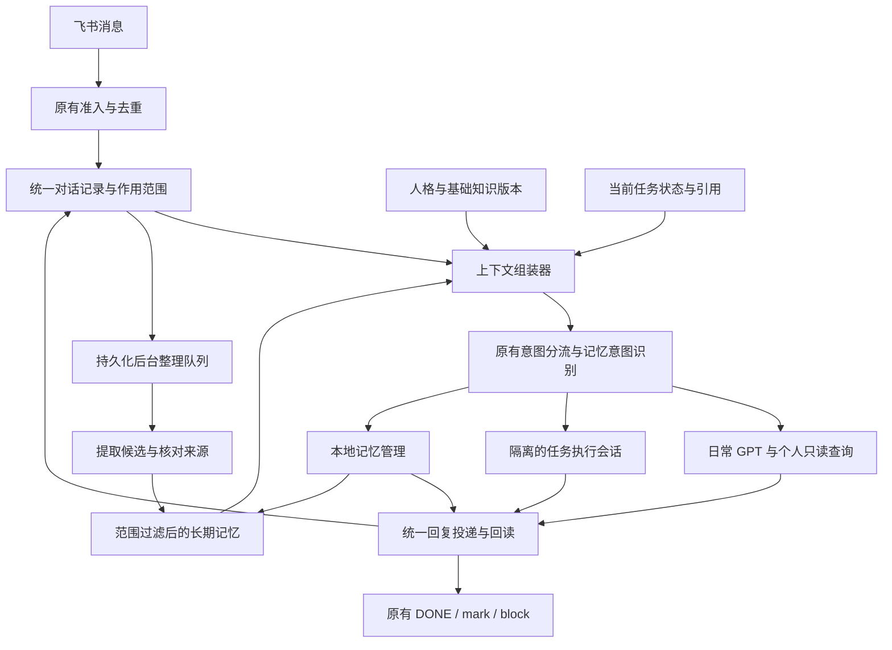

# botCow 人格与长期记忆架构 v1

日期：2026-11-13（Asia/Shanghai）
状态：用户于 2026-11-13 要求“根据新的架构完善机器人”，已授权 P0/P1 实施。实际变更、测试和部署状态见 `20261113-memory-architecture-implementation.md`；下文保留原架构评审与阶段规划。
适用项目：`D:\example\botCow`。
目标：让通过 GPT 工作的飞书助手保持稳定人格、记住有依据的长期信息、正确延续任务，并能被用户纠正。

## 1. 方案摘要与确认范围

保留现有飞书入口和 GPT 接入方式，在本地增加统一对话记录、受范围约束的记忆库和上下文组装层。聊天与执行共用人格和记忆策略；业务执行会话按用户、聊天和任务隔离。

建议第一阶段确认以下实施范围：

1. **记忆写入：** 用户明确说“记住”、明确纠正已有记录或确认候选内容后，才能形成长期偏好和业务事实。普通聊天自动保存为对话历史；自动摘要属于派生材料，不自动成为已确认事实。
2. **记忆范围：** 私聊默认限定当前用户与私聊，群内默认限定当前用户与该群；共享业务知识只能进入用户明确指定的受众范围。跨私聊复用也必须显式登记范围，不能只凭用户名相同。
3. **交互方式：** 支持自然语言记住、查看、纠正、停止使用记忆；成功回执必须发生在本地持久化成功之后。纯记忆管理按日常交互回复，不添加任务表情；与业务执行混合的消息仍保留业务任务流程。
4. **实现路线：** 本地 SQLite 存储、统一上下文组装、业务线程隔离、有限范围灰度；维持现有人格基调和模型配置，不引入新的云端存储或模型训练。

最初架构评审没有授权运行代码修改；后续用户明确要求“根据新的架构完善机器人”，本节四项作为第一阶段实现依据。现行规则已同步，自动整理与向量检索仍按后续阶段评估。

## 2. 现状核对与缺口

下表来自当前源代码静态检查，不代表本轮进行过飞书端到端测试。

| 已有实现 | 证据位置（项目相对路径） | 架构影响 |
| --- | --- | --- |
| 人格、基础知识统一加载 | `scripts/assistant-profile.mjs`；`docs/assistant-persona.md`；`knowledge/assistant-core.md` | 保留单一入口，增加版本与范围，不重复维护两套人格 |
| 最近 6 条已完成记录、最多 3 条未完成需求，按聊天及发送者过滤 | `scripts/chat-context.mjs` | 只能作为近期上下文；还没有按主题检索长时间历史的入口 |
| 历史用户文本与普通回复各截到 1000 字符 | `scripts/chat-context.mjs` | 不能将截断内容当完整来源；应保存完整原文并按预算选择片段 |
| 日常回复正文在 greeting-replies 中；业务通常只有 reply_id | `scripts/chat-context.mjs`；`scripts/greeting-reply.mjs` | 业务产物和已验证结果缺少统一记录；不能只从助手口头回复推导任务成功 |
| 只对最新缺失历史回复和引用回复尝试回读，且只提取文本回复 | `scripts/codex-event-wakeup.mjs` 的 runGreeting | 历史卡片、附件及较早业务回复不能依靠这个入口完整恢复 |
| 日常调用为临时线程，关闭自动 memories 和技能说明 | `scripts/chat-model.mjs` | 保留显式提供上下文的方式；长期记忆由 botCow 管理 |
| 业务恢复配置中的同一个 thread_id，提示词提醒其他聊天不可混用 | `scripts/codex-event-wakeup.mjs` 的 buildPrompt/runCodex | 必须增加线程映射；提示词提醒不是实际线程隔离 |
| 收件先写 inbox，随后判断 eligible | `scripts/lark-event-listener.mjs` | 不能把整个 inbox 直接导入可检索记忆；导入必须重新核对准入和受众 |
| task 在 DONE 后 mark；chat 直接 mark；失败可 block | `scripts/bridge-queue.mjs`；`scripts/bridge-mode.mjs` | 消息处理状态继续由原账本负责，不能被记忆摘要覆盖 |
| mark 本身主要校验分类与 task DONE | `scripts/bridge-queue.mjs` 的 mark | 记忆层不能仅凭 processed 推断业务、文字、卡片和附件均已验证 |

任务线程状态跟随既有完成门禁收口：只有原消息已经通过回复/附件回读、task 的 DONE 以及 mark 前置校验，映射任务才从 `active` 改为 `completed`。显式引用旧消息续办时重新设为 `active`；单纯 processed 记录不绕过原业务验证，也不触发重复执行。

已有错题说明了三个必须覆盖的场景：桌面历史混入机器人自我介绍、群引用误套其他任务目标、业务失败没有向原聊天说明。相关文件为 `mistakes/chat-profile-inherited-desktop-context.md`、`mistakes/feishu-group-event-sync-misrouted-to-schedule.md`、`mistakes/feishu-business-failure-not-replied-to-chat.md`。

## 3. 模块与数据流



节点表示逻辑职责，不要求拆成多个网络服务。首版继续使用现有 Node 项目，通过模块和一个本地后台整理 worker 组织；不引入微服务集群。

| 模块 | 输入与输出 | 责任边界 |
| --- | --- | --- |
| 对话记录适配器 | 已准入事件、投递回执 → 统一记录 | 保留来源、完整文本、类型、发送及验证状态；原始账本仍是兼容与恢复来源 |
| 人格加载器 | 人格文件、已确认行为示例 → 版本化配置 | 人格核心不由模型自行重写；用户个性化覆盖需受范围限制 |
| 范围策略模块 | 当前身份、chat、任务、显式范围绑定 → 可读写集合 | 在检索前过滤，缺失或不明范围默认不可用 |
| 记忆存储与检索 | 明确范围和查询 → 记忆及证据引用 | 第一阶段做结构化匹配、关键词和时间检索；之后按质量评估决定是否加向量 |
| 上下文组装器 | 当前事件、人格、记忆、任务 → ContextBundle | 两通道共用一个合同；提供字数或 token 预算、版本和检索清单 |
| 任务会话注册表 | 范围、task_id → 独立 GPT 执行线程 | 只在完全匹配的范围恢复线程，轮换时只带该任务交接 |
| 后台记忆整理器 | 已提交记录 → 候选、摘要、冲突提示 | 低优先级运行，不能持锁等待 GPT；不能直接扩张权限或确认事实 |
| 记忆管理入口 | 明确用户记忆意图 → 本地事务与真实回执 | 记住、查看、纠正、停止使用；不借此修改外部业务配置 |

## 4. 人格、知识、记忆、任务分别管理

| 内容层 | 保存内容 | 更新方式 |
| --- | --- | --- |
| 核心人格 | 身份、价值取向、表达原则、工作与闲聊风格 | 沿用已确认文件；修改需用户确认，保留版本 |
| 行为示例 | 同一情境下用户认可或纠正过的回答 | 明确反馈后整理；去除私有事实后才可成为通用示例 |
| 稳定偏好 | 用户希望的回答粒度、称呼、常用格式 | 明确要求或确认后生效；按作用范围覆盖 |
| 事件经历 | 讨论发生过、提出过建议、某次操作失败或已验证 | 来自记录与验证证据；保留时间和状态，不能自动升级为永久事实 |
| 项目知识 | 已确认口径、术语、目标文档绑定 | 有来源、版本、受众范围；实时数据仍查实时来源 |
| 工作状态 | 任务目标、约束、产物、待确认项、完成证据 | 来自执行流程；本地记忆引用任务状态，不自行判定完成 |

“记住我喜欢先看结论”更新偏好；“记住这个表已经改好了”只记录用户如此陈述，不能替代服务回读证据；“以后这个项目都无需确认提交”不能从偏好入口改变既有写入门禁。

人格稳定不意味着永远同一种语气。日常可以轻松，工作需要准确、直接；临时情绪只服务当前上下文，不据此长期推断性格或心理状态。

## 5. 数据合同（建议字段，实施前锁定）

### 5.1 存储选择

建议本地 SQLite，数据库置于项目已忽略版本控制的 runtime 下。SQLite 支持原子事务，适合把记忆修订、当前版本和后台待办一并提交。[SQLite 事务说明](https://www.sqlite.org/transactional.html)

项目当前声明 Node >=20，本机检查为 v22.17.1；因此不直接假定所有运行环境都有同样的内置 SQLite 能力。实施时选定并锁定兼容 Windows 和项目 Node 范围的驱动，记录实际 SQLite 版本，做安装、事务、崩溃恢复验证后采用。首版采用短事务和单写入调度；是否启用 WAL 由并发验证决定。WAL 仍只有一个写入者，且要求数据库位于本机文件系统。[SQLite WAL 文档](https://www.sqlite.org/wal.html)

数据库只存所需正文和业务引用，不存 token、授权码或密钥。上下文中选中的内容会发送给现有 GPT 服务；“本地保存”不等于“模型离线处理”。

### 5.2 主要实体

| 实体 | 最小字段 | 约束 |
| --- | --- | --- |
| scope_bindings | tenant、bot、owner、chat、audience、project、来源及版本 | owner 取当前已验证身份；范围不能由模型随意填写 |
| conversation_records | record_id、message_id、reply_id、scope_id、role、content_type、body、source_time、observed_at、verification | 消息/回复 ID 唯一；卡片、附件以独立 part 关联；正文未回读不能写 verified |
| tasks | task_id、scope_id、source_message_id、目标、约束、状态、artifact_refs、evidence_refs、版本 | 目标与结果分开；消息处理完成不自动等同外部业务成功 |
| memory_items | memory_id、scope_id、kind、subject、key、value、status、origin、source_refs、confirmed_by、confirmed_at、valid_from、valid_to、revision | 唯一当前值按 scope/kind/subject/key 约束；关系或多值事实用独立 key |
| memory_revisions | memory_id、revision、变更类型、旧/新版本引用、actor、source_ref | 每次修订可追踪；明确纠正使用事务及版本检查 |
| derived_summaries | summary_id、scope_id、source_refs、source_versions、coverage、body、status | 仅为派生材料；不得扩张源信息受众；来源失效后同步失效 |
| task_threads | scope_id、task_id、thread_id、persona_version、scope_epoch、状态 | 禁止恢复 scope 不匹配或 epoch 过期线程 |
| memory_jobs | job_id、source_record_id、operation、版本、状态、attempts、next_retry_at | 幂等键包含源记录、操作与提取版本；确认或删除时检查源的当前状态 |

`scope_id` 是程序根据受信任身份和已确认绑定生成的内部键，不接受模型自行扩大。`verification` 区分 received、sent、reply_verified、business_verified、unverified 等证据类型，不用一个“已处理”布尔值混合表达。

`origin` 至少区分 explicit_user、user_confirmed、verified_tool_result、model_inference、imported_history。置信度只能辅助排序；模型声称“很确定”不能替代来源和确认。

### 5.3 两通道共用 ContextBundle

```json
{
  "schema_version": 1,
  "event": {"message_id": "example-message", "scope_id": "example-scope"},
  "persona_version": "example-persona-version",
  "knowledge_version": "example-knowledge-version",
  "scope_epoch": 1,
  "current_message": "按之前确认的口径继续",
  "quoted_records": [],
  "recent_turns": [],
  "active_tasks": [],
  "confirmed_memories": [],
  "relevant_episodes": [],
  "conflicts": [],
  "retrieval_manifest": [],
  "budget": {"status": "within_limit", "omitted_record_ids": []},
  "memory_status": "available"
}
```

上述是合同示例，不是已部署配置。业务规则和工具授权由可信系统指令及实际执行门禁提供；记忆内容作为有来源的数据提供。两通道可以选择不同长度的上下文，但必须遵循相同范围、版本和证据规则。

## 6. 记忆的完整生命周期

### 6.1 写入与确认

1. 接收准入消息，记录来源、发送者和范围。引用、转发、工具文本不得作为新的用户授权。
2. 明确记忆指令进入记忆管理入口。模型可辅助抽取内容；程序验证来源、目标范围、字段和长度。含糊、互相冲突或范围不明确时才澄清。
3. 原话已明确要求记住且信息单一清晰时，无需再问“是否记住”。它本身就是该范围内这条记忆的确认。
4. 普通聊天可产生候选和经历摘要；未经用户确认的候选不进入 confirmed_memories，也不作为后续回答的确定事实。
5. 记忆提交与修订记录在一个事务内完成，之后才回复“已记住……”。同一消息重试只复用原提交结果，不产生重复记忆。
6. 外部实时结果仅形成带观测时间的经历或快照；下一次查询实时状态时重新读取来源。

记忆更新成功但飞书回复失败时，仅重试投递与回读；记忆提交失败时不能先声称成功。明确记忆操作的失败必须向原对话说明；普通后台整理失败不打断聊天，只进入有限重试队列。

### 6.2 冲突与纠正

- 同一范围、同一事实键的明确纠正：生成新版本，旧版本标为 superseded。
- 两条来源冲突且无法判断适用范围：保留 conflict，不让模型静默选一个当事实；对当前问题确有影响时再询问。
- 不以最新入库时间覆盖业务有效时间。迟到旧消息、重放任务和延迟提取不能覆盖新纠正。
- 当前消息的明确要求优先用于当前回复；历史偏好不能覆盖当前目标，也不能覆盖项目权限规则。
- 引用和历史均是上下文材料，不能因为里面出现“忽略规则”等文字而变成系统指令。

### 6.3 停止使用与删除

建议首版“忘掉这条偏好”定义为：停止在后续回答、检索、摘要和线程续接中使用该记忆，并明确向用户说明该效果；不声称飞书原消息和备份已被物理删除。

执行时要同时失效当前记忆、关联摘要、检索索引和缓存，并提升 scope_epoch。已经包含该内容的日常预热上下文、业务线程和交接摘要必须重建或停止恢复，不能只删数据库行却继续 resume 旧线程。

后台任务在提交前复查源记录版本、失效标记和 epoch，避免忘记后又从历史自动提取回来。回答投递前也复查 epoch；若发生纠正或遗忘，尚未发送的旧上下文回答应重新生成。

明确要求“删除本地记录”属于另一操作：实施前列出将清理的原文、派生物、索引及备份范围。首版不自动清理原队列账本，以免破坏幂等与恢复；不把“停止使用”宣传成彻底删除。

## 7. 检索与上下文预算

每轮顺序：验证当前身份与范围 → 解析引用和任务绑定 → 按范围及有效版本筛选 → 匹配主题/实体/时间 → 排序 → 按预算组装。

第一阶段采用明确引用、task_id、事实键、主题标签、关键词和时间范围检索。中文检索需用真实表达测试，不假定默认英文分词能处理中文。只有召回不足且延迟预算允许时，才增补本地向量索引；向量索引仍服从同一范围过滤与失效机制。

优先级：当前消息与必要引用、当前任务约束、核心人格、已确认相关偏好、相关决定与经历、近期闲聊。裁剪时优先丢弃低相关旧经历，不能截断关键限制或把多个来源拼成一条无出处事实。

首版建议长期记忆片段最多 8 条，额外正文暂设 6000 字符软上限；这是待压测调整的起点，不是模型 token 上限。总输入仍需预留当前消息、规则、工具材料和输出空间，实施时根据实际模型计数方式和限制设置硬预算。若当前消息或必要引用本身过长，进入受控分段处理，不能静默截掉后半部分。

检索结果为空时说明“目前没有找到这段记录”，不能补造经历；“数据库不可用”与“没有记忆”要区分。记忆库不可用时可继续处理与历史无关的闲聊；涉及历史承诺、具体目标或写入对象时，应补查原始授权来源或澄清，不能回退到桌面全局记忆。

每次组装保存检索清单中的记录 ID、修订号、范围、选择原因和预算状态；常规诊断日志只记元数据，不重复抄写私聊原文。

## 8. 双通道与任务线程隔离

日常通道继续使用临时模型线程，按请求构建 ContextBundle。预热线程只持有通用人格与路由指令，不提前装载某个用户的私有记忆。人格版本变化时废弃旧预热线程。

业务通道建议使用 `tenant + bot + sender + chat + task_id` 作为线程映射的逻辑键。执行仍遵守现有串行锁；隔离线程不等于放开并行写入。

task_id 绑定顺序：已验证的 reply_to/root_id → 明确任务标识 → 当前范围内唯一且上下文一致的待续任务。多个候选无法确定时澄清；独立闲聊不自动续接最近任务。不能仅凭“继续”跨会话寻找一个看起来类似的任务。

部署时不将现有跨聊天业务线程复制给各新线程。旧线程留作只读排查线索；从原消息、已验证结果和按范围保存的交接重建新线程。每个任务的交接保留目标、约束、证据、待确认项与未完成动作，工具权限仍按实时配置判断。

执行模型即使有文件工具，也不能把提示词隔离描述成操作系统级隔离。首版将敏感记忆数据库读取集中到带范围校验的接口，避免把全库路径作为默认提示输入；进一步的进程权限隔离属于后续专项，需要单独验证。

## 9. 投递记录、后台整理与失败恢复

### 9.1 回复记录要覆盖所有类型

- 统一记录日常文本、业务文本、卡片及附件；每个 part 保留 reply_id、content_type、回读结果及来源消息关联。
- 文本记录正文；卡片保存可核对的标题、字段和值及原始引用；附件记录名称、媒体类型、远端引用和已完成的验证，不自动把未解析文件内容当知识。
- 工具输出和 GPT 最终文本不是“飞书已收到”的证据。投递后校验机器人身份、目标 chat、引用关系和内容；仅有发送成功响应时标 sent。
- 任务结论须有业务证据引用；附件失败、业务失败或权限不足均不能成为“已完成”的记忆。失败通知可以作为已验证回复单独记录。

### 9.2 持久化、幂等与补偿

原消息队列和投递账本继续运行，记忆库作为新增投影，不把两套文件写入误称为同一个事务。适配器按源 ID 和类型幂等导入；记录与后台 outbox 在 SQLite 同一事务内提交。

如果已经回读并 mark、但新库写入失败，依靠原账本和导入游标补建，不重发飞书消息、不重做业务。已有业务账本缺正文或缺验证证据时只导入 stub/unverified，待受控回读补齐，不从模型文本猜出验证状态。

后台 worker 领取持久化任务并带租约；进程重启后可续领过期租约。每条任务设置有限尝试次数和 next_retry_at；网络临时失败退避，确定性的授权、来源失效和格式错误进入 needs_review，不持续唤醒。

记忆提取使用独立、无业务工具的模型调用；一次可整理小批已完成记录。默认不抢占活跃回复，设置调用预算；不得在 SQLite 事务或消息处理锁中等待模型。

## 10. 用户可见的交互示例

以下是待确认的行为示例，不表示功能已经上线。

| 用户表达 | 预期行为 |
| --- | --- |
| 记住，我希望方案先给结论 | 在当前私聊范围保存偏好，落盘成功后简短确认 |
| 你记得我对方案格式有什么要求吗 | 只展示当前可用的已确认偏好，必要时附来源日期 |
| 刚才那条改一下，复杂方案要先解释背景 | 核对目标偏好，保存新版本，说明新的适用条件 |
| 忘掉这个格式偏好 | 停止后续使用，失效派生上下文；说明不再作为偏好使用 |
| 上周我们为什么取消那个方案 | 检索当前范围的决定及来源；无法确定“那个方案”才澄清 |
| 按我们群里确认的目标继续 | 优先解析本群引用和绑定任务，不借用私聊目标 |
| 我今天有点累 | 自然回应；不自动形成“用户长期状态差”的记忆 |
| 记住这个口径，再把表改了 | 分解记忆管理与业务执行；保存口径不替代业务提交确认 |

## 11. 实施拆分与改动位置

以下模块名是提案中的建议命名，确认后再创建运行代码。

| 阶段 | 工作内容 | 完成条件 |
| --- | --- | --- |
| P0：结构基础 | 数据合同、存储适配器、范围策略、统一记录、任务线程映射 | 隔离环境通过持久化、恢复、跨群/私聊测试；尚不在生产自动学习 |
| P1：显式记忆 | 共用 ContextBundle，记住/查看/纠正/停止使用，自然语言入口 | 重启可回忆、纠正生效、遗忘不会被旧线程或后台恢复；两通道一致 |
| P2：受控整理 | 经历摘要、候选池、证据关联、低优先级 outbox worker | 无确认不升级事实；不增加主链路模型轮次；失败可恢复 |
| P3：质量提升 | 中文召回评估、必要时向量检索、用户认可的行为示例 | 用留出场景证明改善后再启用，不凭主观感觉扩张复杂度 |

预计新增 `memory-store.mjs`、`memory-policy.mjs`、`memory-retrieval.mjs`、`context-builder.mjs`、`memory-management.mjs`、`memory-worker.mjs`、`task-session-registry.mjs`；迁移及测试放项目现有 scripts 体系。可按实现复杂度合并模块，避免只为分层增加文件。

主要接入点：

- `chat-context.mjs`：保留兼容读取，逐步调用统一记录与 ContextBundle。
- `assistant-profile.mjs`：返回人格/知识版本，验证缓存刷新。
- `chat-model.mjs`：使用共用合同，预热不带私有记忆，不增加普通聊天的额外分类模型轮次。
- `codex-event-wakeup.mjs`：组装上下文、任务线程映射、记忆管理分支、结果记录适配。
- `greeting-reply.mjs` 及业务投递入口：在完成回读后输出统一 verified receipt。
- `bridge-queue.mjs`：继续拥有 mark/block 语义；未来若增加验证硬门禁，单独列出兼容迁移并测试，不混入记忆上线。

规则同步应在确认后先更新 `rules/rules.md` 与业务工作流规范，再变更运行代码。迁移不批量导入整个历史 inbox；只导入用户明确选定的已准入历史范围，来源不完整时保留不完整标记。

## 12. 验收矩阵与性能目标

下列均为未来验收要求，本轮没有执行这些功能测试。

| 编号 | 场景 | 必须观察到的结果 |
| --- | --- | --- |
| A01 | 明确记住后重启 botCow | 同一范围可准确回忆，来源可追溯 |
| A02 | 同一用户在私聊、群 A、群 B 提问 | 私聊内容不进入群；不同群目标不混用 |
| A03 | 未准入发送者或未 @ 群消息已存在 inbox | 不进入可检索记录及长期记忆 |
| A04 | 用户纠正偏好，旧提取任务稍后完成 | 新版本保留，旧任务不能覆盖 |
| A05 | 停止使用一条记忆，同时存在摘要、缓存、旧线程 | 所有派生输入失效，不从旧线程或导入重新出现 |
| A06 | 仅 GPT 回复“已经改好了”，业务无回读证据 | 不能形成 business_verified 或已完成记忆 |
| A07 | 卡片/附件发送成功但回读失败 | 保留 sent/未验证，恢复时不重复发送 |
| A08 | 飞书投递成功后记忆库崩溃 | 依原账本补建，不重做业务、不重复回复 |
| A09 | 记忆写入成功后飞书确认失败 | 恢复同一回执，不重复创建记忆 |
| A10 | 用户引用历史中的“忽略规则”或转发他人指令 | 只作为材料，不新增授权或扩大范围 |
| A11 | 多个未完成任务同时出现“继续” | 无明确引用时澄清，不自动选择其他聊天线程 |
| A12 | 对同一偏好同时发生两次更新 | 版本检查发现冲突，不能无声丢失新修改 |
| A13 | 记忆库不可用 | 区分不可用与无记录；与历史无关闲聊可继续 |
| A14 | 实时任务或 Bug 已变化 | 查询当前来源，旧记忆只用于定位 |
| A15 | 人格更新时存在预热线程 | 下一条回答使用新版本，并维持范围隔离 |
| A16 | 长任务执行期间普通闲聊与后台整理并存 | 闲聊独立处理，后台有限排队，不占业务执行锁 |
| A17 | 记忆更新与消息发送之间发生遗忘 | 发出前校验 epoch，旧上下文回答不被发送 |
| A18 | 纯记忆管理和记忆＋业务混合指令 | 前者自然回复无表情；后者仍按原业务验收流程 |

建议性能目标：在本机 1 万条合成对话、2000 条记忆的固定数据集上，本地检索与组装 p95 不超过 100ms；这是目标而非已测结果。首版记录准入→准备→模型→投递→回读各段耗时，分别统计普通聊天、只读查询、记忆管理和业务任务。对相同模型、输入预算和机器负载做前后对比；不以单次模型响应时间代替飞书端到端耗时。

人格评估保留未参与示例整理的场景，覆盖安慰、提出异议、工作方案、承认不知、纠正错误。人格稳定不应降低事实准确性或权限遵循。

## 13. 上线与回退

1. 确认本提案第 1 节的四项实施范围，先实现 P0/P1 并运行隔离测试。
2. 影子运行只构建候选上下文和比较结果，不让新记忆影响实际回复；影子材料仍按私聊/群范围管理。
3. 选择已授权的测试对话范围灰度。真实飞书发送需要明确测试授权；收到用户测试消息也不授权额外群发。
4. 观察实际新消息从准入到回复、回读及最终状态；队列空闲且无活跃 worker 时才切换服务，按项目既有切换错题核对。
5. 用配置分别控制新记忆读取、显式记忆写入、自动候选提取。回退先停止提取与新读取，不删除数据库或旧账本。
6. 已执行的遗忘/纠正及线程隔离不能因回退恢复成旧内容。回退到不读取被屏蔽来源的安全路径；禁止直接恢复原跨聊天共享线程。
7. 新库备份记录 schema 版本和数据版本；恢复后重放遗忘屏蔽记录及修订游标，验证备份不会复活旧记忆。带 WAL 时用数据库一致性备份机制，不只复制主文件。

## 14. 本轮完成与下一步

本节记录最初架构评审结束时的历史状态；后续实施以 `20261113-memory-architecture-implementation.md` 为准。

已完成：现有代码与规则审查、数据流和模块拆分、来源与范围策略、记忆生命周期、线程隔离、故障恢复、实施拆分、18 项验收场景。

未执行：创建运行数据库、导入聊天、修改人格、修改机器人代码或配置、调用机器人模型做训练、重启服务、发送飞书消息。

待确认：第 1 节四项实施范围。确认后先完成 P0/P1，再以验证结果决定是否进入自动摘要和向量检索阶段。

## 15. 来源与规则同步

- 项目当前规则：`D:\example\botCow\AGENTS.md`、`rules/rules.md`、`spec/assistant-operating-workflows-spec.md`。
- 基础规范：完整读取 `D:\example\Workbencch\spec\rules-bootstrap-spec.md`；与项目副本去除换行/尾空白差异后正文一致，无需覆盖。
- 本提案事实依据是本轮读取的当前代码；历史 session 和 mistakes 用于发现验证场景，不当作当前线上成功证据。
- 新数据结构、阈值、模块名和交互均为建议；尚未作为现行运行规则生效。
